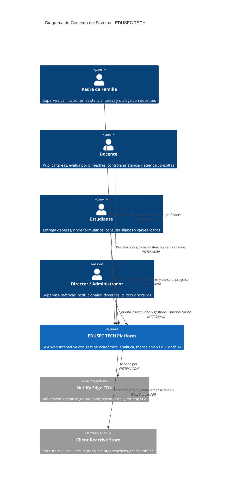
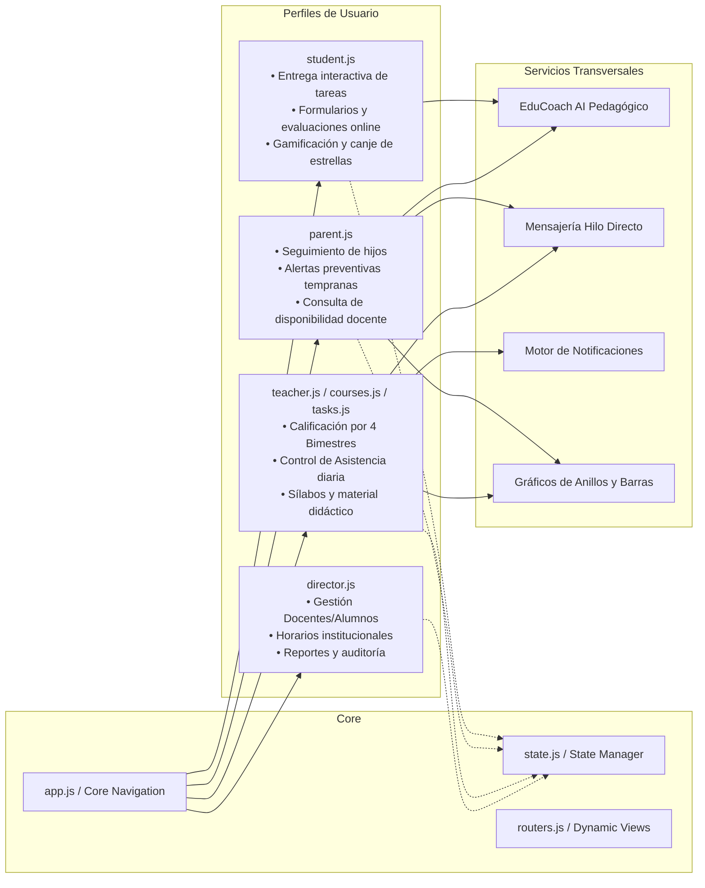
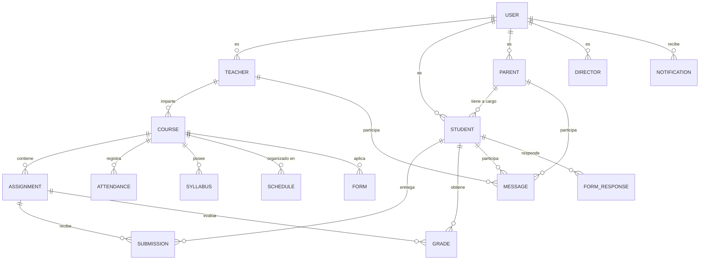
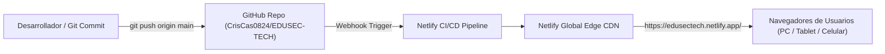

# Arquitectura de Software — EDUSEC TECH (V6 Avanzado)

Plataforma Web Integral de Gestión Académica, Seguimiento Escolar, Comunicación en Tiempo Real y Asistencia Pedagógica con Inteligencia Artificial.

---

## 1. Resumen Ejecutivo y Propósito

**EDUSEC TECH** es una solución tecnológica educativa diseñada para optimizar y conectar los cuatro pilares fundamentales de la comunidad escolar: **Dirección/Administración**, **Cuerpo Docente**, **Padres de Familia** y **Estudiantes**.

La arquitectura está construida bajo el patrón de **Single Page Application (SPA)** de alto rendimiento con **Vanilla JavaScript (ES6+)**, sin sobrecarga de dependencias externas pesadas, asegurando tiempos de carga ultrarrápidos, total portabilidad, ejecución en el borde (Edge CDN) y persistencia reactiva en cliente mediante un motor de almacenamiento estructurado.

### Atributos Clave de Calidad
- **Rendimiento:** Carga inicial < 1.0s, tiempo de respuesta a eventos de interfaz < 50ms.
- **Portabilidad y Compatibilidad:** Funciona en cualquier navegador moderno sin herramientas de compilación complejas.
- **Inclusividad:** Cumplimiento con la **Ley N.º 29733** (Ley General de la Persona con Discapacidad) y estándares **WCAG 2.1**, con soporte bilingüe (Español / Quechua).
- **Seguridad:** Control de Acceso Basado en Roles (**RBAC**) estricto para aislar vistas y datos por perfil.

---

## 2. Diagrama de Arquitectura C4

### Nivel 1: Diagrama de Contexto del Sistema (System Context)



---

### Nivel 2: Diagrama de Contenedores (Container Diagram)

```mermaid
graph TD
    subgraph Cliente Browser
        UI["Capa de Presentación (HTML5 / Vanilla CSS3 / SVG)"]
        Router["Módulo de Enrutamiento y Navegación Dinámica (routers.js, app.js)"]
        StateEngine["Motor de Estado Reactivo y Persistencia (state.js, seed.js)"]
        
        subgraph Modulos de Negocio
            Auth["Módulo de Autenticación y RBAC (app.js)"]
            Academic["Gestión Académica y Bimestres (bimesters.js, tasks.js)"]
            Attendance["Control de Asistencia (attendance.js)"]
            Messaging["Centro de Mensajería y Notificaciones (messages.js, notifications.js)"]
            Forms["Motor de Formularios y Evaluaciones (forms-*.js)"]
            AI["EduCoach AI Engine (ai-assistant.js, ai-data.js)"]
            Availability["Módulo Hora Docente (availability.js)"]
        end

        LocalStorage[("Almacenamiento Local (LocalStorage JSON Store)")]
    end

    subgraph Infraestructura Cloud
        Netlify["Netlify Edge Hosting (CDN / netlify.toml)"]
        GitHub["GitHub Repository (Control de Versiones y Despliegue Continuo)"]
    end

    UI <--> Router
    Router <--> Modulos de Negocio
    Modulos de Negocio <--> StateEngine
    StateEngine <--> LocalStorage
    GitHub -->|Auto-deploy en git push| Netlify
    Netlify -->|Distribución HTTPS| UI
```

---

### Nivel 3: Diagrama de Componentes por Rol



---

## 3. Arquitectura en Capas del Frontend

El proyecto adopta una arquitectura en capas desacopladas organizada en `public/assets/`:

```
public/assets/
│
├── css/
│   ├── base/               # Capa Base: reset, variables de diseño, layout central
│   │   ├── layout.css
│   │   ├── reset.css
│   │   └── variables.css
│   ├── components/         # Capa de Componentes Atómicos y Moleculares
│   │   ├── buttons.css
│   │   ├── cards.css
│   │   ├── charts.css
│   │   ├── login.css
│   │   ├── overlays.css
│   │   ├── sections.css
│   │   ├── tables.css
│   │   ├── topnav.css
│   │   └── widgets.css
│   └── responsive/         # Adaptabilidad móvil/tablet/escritorio
│       └── responsive.css
│
└── js/
    ├── utils/              # Servicios Base y Utilidades
    │   ├── app.js          # Orquestador del ciclo de vida y eventos globales
    │   ├── state.js        # Estado central reactivo e interactores de persistencia
    │   ├── charts.js       # Renderizado de métricas y gráficos SVG
    │   └── ai-config.js    # Parámetros y contexto de EduCoach AI
    ├── data/               # Semillas de Datos y Modelos
    │   ├── seed.js         # Estructura inicial de la base de datos relacional
    │   ├── seeders.js      # Población masiva de registros demo
    │   ├── messages-data.js# Hilos y mensajes directos
    │   ├── ai-data.js      # Conocimiento y reglas pedagógicas de IA
    │   └── forms-data.js   # Preguntas y bancos de evaluación
    ├── components/         # Componentes Lógicos Reutilizables
    │   ├── shared.js       # Helpers y constructores visuales comunes
    │   ├── routers.js      # Despachador de páginas por rol
    │   ├── messages.js     # Interfaz de mensajería
    │   ├── messages-logic.js
    │   ├── notifications.js# Panel flotante de alertas y campanita
    │   ├── calendar.js     # Calendario interactivo de 12 meses
    │   ├── availability.js # Semáforo de disponibilidad ("Hora Docente")
    │   ├── ai-assistant.js # Ventana modal y chat interactivo con EduCoach
    │   ├── ai-integration.js
    │   └── forms-*.js      # Creación, renderizado y envío de formularios
    ├── director/           # Módulo Director
    │   └── director.js
    ├── teacher/            # Módulo Docente
    │   ├── teacher.js
    │   ├── courses.js
    │   ├── tasks.js
    │   ├── attendance.js
    │   └── bimesters.js
    ├── parent/             # Módulo Padre de Familia
    │   └── parent.js
    └── student/            # Módulo Estudiante
        └── student.js
```

---

## 4. Esquema de Entidades y Modelo de Datos (ERD)

El almacenamiento cliente estructura un esquema relacional normalizado persistido bajo el namespace `STORE = 'edusec_tech_v6'` en `localStorage`:



---

## 5. Control de Acceso Basado en Roles (RBAC)

La plataforma aplica un modelo de seguridad por perfil donde cada usuario dispone de permisos estrictamente delimitados:

| Característica / Módulo | Director / Admin | Docente | Padre de Familia | Estudiante |
| :--- | :---: | :---: | :---: | :---: |
| **Dashboard Ejecutivo General** | ✅ | ❌ | ❌ | ❌ |
| **Gestión de Usuarios y Roles** | ✅ | ❌ | ❌ | ❌ |
| **Asignación de Cursos y Horarios** | ✅ | ❌ | ❌ | ❌ |
| **Publicación de Tareas y Sílabos** | ❌ | ✅ (Solo sus cursos) | ❌ | ❌ |
| **Registro de Notas (4 Bimestres)** | ❌ | ✅ (Solo sus cursos) | ❌ | ❌ |
| **Control Diario de Asistencia** | ❌ | ✅ (Solo sus cursos) | ❌ | ❌ |
| **Entrega de Deberes y Formularios** | ❌ | ❌ | ❌ | ✅ |
| **Canje de Logros y Gamificación** | ❌ | ❌ | ❌ | ✅ |
| **Seguimiento Familiar Multihijo** | ❌ | ❌ | ✅ | ❌ |
| **Semáforo "Hora Docente"** | 👁️ Lectura | ⚙️ Configurable | 👁️ Consulta y Cita | 👁️ Consulta |
| **EduCoach AI Pedagógico** | ❌ | ❌ | ✅ | ✅ |
| **Mensajería Bidireccional** | ✅ | ✅ | ✅ | ✅ |

---

## 6. Módulos y Flujos de Negocio Principales

### 6.1. Ciclo de Calificación por 4 Bimestres
1. El docente accede a su curso asignado.
2. Selecciona la tarea o evaluación correspondiente al Bimestre activo (I, II, III o IV).
3. Ingresa la calificación vigesimal (0 a 20) y retroalimentación pedagógica.
4. **Motor de Reglas Automático:**
   - Si la nota es $\le 10$, se dispara una **Alerta Preventiva Temprana** dirigida al padre de familia.
   - Si la nota es $\ge 17$, se dispara un reconocimiento de alto rendimiento y se acreditan **estrellas de gamificación** al alumno.
5. El promedio ponderado bimestral se recalcula inmediatamente en los gráficos de anillos del alumno y del padre.

### 6.2. Motor de Asistencia Inteligente
- Registro rápido por curso con estados: `Presente`, `Tardanza`, `Falta` y `Justificada`.
- Almacenamiento con marca de tiempo diaria.
- Cálculo dinámico de tasa de asistencia porcentual ($\% = \frac{\text{Presentes}}{\text{Total Sesiones}} \times 100$).
- Notificación preventiva inmediata al padre cuando se registra inasistencia o tardanza reiterada.

### 6.3. Asistente Pedagógico EduCoach AI
- Analiza de forma contextual el historial de calificaciones y asistencia del estudiante.
- Genera recomendaciones de estudio personalizadas, técnicas de refuerzo escolar y orientación familiar preventiva.
- Totalmente integrado en la interfaz mediante ventana modal de fácil acceso.

### 6.4. Disponibilidad Docente ("Hora Docente")
- Permite a los profesores indicar su estatus en tiempo real:
  - 🟢 **Libre:** Disponible para consultas rápidas de mensajería.
  - 🟡 **Solo Cita Previa:** Requiere coordinación previa.
  - 🔴 **Ocupado:** En dictado de clase o evaluación.
- Reduce la saturación de mensajes y llamadas fuera de horario escolar.

---

## 7. Despliegue e Infraestructura Cloud



- **Dominio y URL en Producción:** `https://edusectech.netlify.app/`
- **Configuración Netlify (`netlify.toml`):**
  - Directorio de publicación: `.` (Raíz)
  - Reglas de redirección SPA: `/* -> /index.html` con estado `200`
- **Zero Build Step:** La arquitectura no requiere transpiladores pesados, lo que permite despliegues atómicos instantáneos (< 15 segundos).

---

## 8. Cumplimiento Normativo y Accesibilidad

- **Ley N.º 29733 (Perú):** Garantía de acceso a la información y comunicación para estudiantes y familiares con discapacidad.
- **WCAG 2.1 Nivel AA:** Alto contraste visual, jerarquía tipográfica legible, tamaños táctiles para pantallas móviles y navegación compatible con lectores de pantalla.
- **Interculturalidad:** Soporte bilingüe en lengua originaria (Quechua) y Castellano para asegurar inclusión en comunidades escolares diversas.

---

*Documento técnico elaborado para la entrega final de Generación de Empresa (Ciclo 7) — EDUSEC TECH.*
