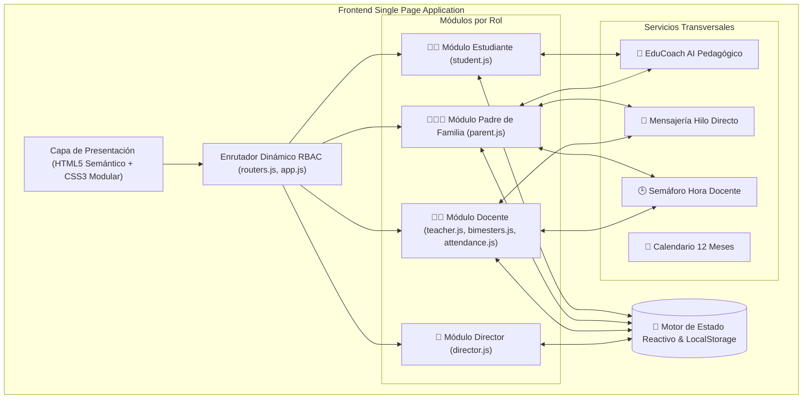

# 🏫 EDUSEC TECH (V6 Avanzado)

> **Plataforma Web Integral de Gestión Académica, Seguimiento Escolar, Comunicación en Tiempo Real y Asistencia Pedagógica con Inteligencia Artificial.**

[](https://github.com/CrisCas0824/EDUSEC-TECH)
[](https://github.com/CrisCas0824/EDUSEC-TECH)
[](./ARCHITECTURE.md)
[](https://github.com/CrisCas0824/EDUSEC-TECH)

---

## 🏛️ Documentación de Arquitectura de Software

Para una revisión en profundidad de los diagramas C4, modelo de datos ERD, flujos de negocio y matriz RBAC:
- 📄 **[Documento de Arquitectura de Software (ARCHITECTURE.md)](./ARCHITECTURE.md)**
- 📊 **[Dashboard Visual Interactivo de Arquitectura (docs/ARQUITECTURA.html)](./docs/ARQUITECTURA.html)**

### Resumen de Arquitectura del Sistema



---

## 🔑 Credenciales de Acceso Demo

Todos los usuarios cuentan con la contraseña por defecto: **`123456`**. En la pantalla de inicio de sesión también dispones de accesos rápidos (*quick buttons*).

| Rol | Correo de Acceso | Funcionalidades Destacadas |
| :--- | :--- | :--- |
| **Director / Admin** | `director001@edusec.pe` | Gestión institucional de docentes, alumnos, padres, asignación de cursos, horarios y auditoría general. |
| **Docente** | `docente001@edusec.pe` *(hasta docente050)* | Calificación por 4 bimestres, publicación de tareas, control de asistencia diaria, sílabos y configuración de disponibilidad. |
| **Padre de Familia** | `padre001@edusec.pe` *(hasta padre200)* | Monitoreo multihijo, alertas tempranas de notas bajas/inasistencias, consultas pedagógicas con EduCoach AI y citas docentes. |
| **Estudiante** | `estudiante001@edusec.pe` *(hasta estudiante300)* | Entrega interactiva de tareas, formularios/evaluaciones cronometradas, avance por bimestres y canje de estrellas. |

---

## ✨ Principales Características e Innovaciones

1. **Calificación Oficial por 4 Bimestres:**
   - Registro con alertas tempranas automáticas: notas $\le 10$ notifican de inmediato al padre; notas $\ge 17$ otorgan estrellas de excelencia.
2. **Semáforo "Hora Docente Disponible":**
   - Estados en tiempo real: 🟢 *Libre*, 🟡 *Solo Cita Previa*, 🔴 *Ocupado*, reduciendo mensajes intrusivos fuera de horario.
3. **Asistente Pedagógico EduCoach AI:**
   - Análisis inteligente contextual del rendimiento del estudiante con consejos pedagógicos prácticos para padres y alumnos.
4. **Control Diario de Asistencia:**
   - Registro inmediato por curso y sesión (`Presente`, `Tardanza`, `Falta`, `Justificada`) con cálculo porcentual acumulativo.
5. **Gamificación y Logros:**
   - Reconocimiento con insignias y canje de estrellas para motivar el cumplimiento y excelencia estudiantil.
6. **Formularios y Evaluaciones Online:**
   - Motor para rendir cuestionarios con límite de tiempo, guardado progresivo y autocalificación.
7. **Diseño Responsive con Menú Hamburguesa:**
   - Adaptación fluida para smartphones, tablets, laptops y pantallas de escritorio.
8. **Inclusión y Accesibilidad:**
   - Soporte bilingüe (Español / Quechua) y cumplimiento de lineamientos de la **Ley N.º 29733** y **WCAG 2.1**.

---

## 📂 Estructura del Proyecto

```
EDUSEC-TECH/
├── index.html                  # Punto de entrada de la aplicación SPA
├── ARCHITECTURE.md             # Especificación técnica y arquitectura de software
├── README.md                   # Documentación principal del repositorio
├── serve.bat                   # Script de ejecución local en Windows (CMD)
├── serve.ps1                   # Script de ejecución local en PowerShell
├── docs/                       # Documentación adicional y prototipos
│   ├── ARQUITECTURA.html       # Visualizador interactivo de arquitectura
│   ├── DIRECTOR-MODULE.html    # Prototipo del módulo director
│   ├── README.txt              # Historial de parches y versiones
│   └── V4-PROPUESTA.txt        # Especificación de requerimientos
├── img/                        # Recursos gráficos y logotipo oficial
│   └── logo.png
└── public/
    └── assets/
        ├── css/                # Hojas de estilo modulares (base, components, responsive)
        └── js/                 # Lógica modular (admin, components, data, director, parent, student, teacher, utils)
```

---

## 🚀 Ejecución en Entorno Local

Al tratarse de una arquitectura puramente estática en cliente, no requiere instalación de dependencias pesadas (`node_modules`).

### Opción 1: Scripts incluidos
- En Windows (PowerShell):
  ```powershell
  .\serve.ps1
  ```
- En Windows (CMD / Doble clic):
  ```cmd
  serve.bat
  ```

### Opción 2: Cualquier servidor web local
- Con Python:
  ```bash
  python -m http.server 8080
  ```
- O abriendo directamente `index.html` en tu navegador web preferido.

---

## 🎓 Información Académica

- **Asignatura:** Generación de Empresa
- **Nivel:** Ciclo 7 — Entrega Final
- **Autor / Desarrollador:** Cristian ([@CrisCas0824](https://github.com/CrisCas0824))

---
*EDUSEC TECH &copy; 2026. Todos los derechos reservados.*
